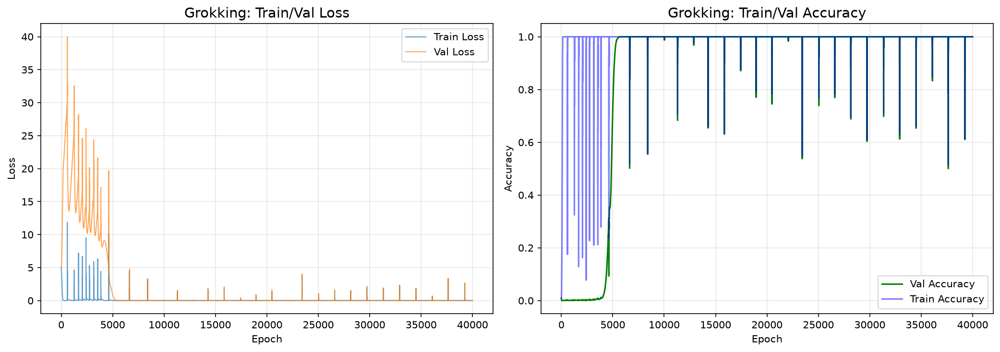

# From Gradient to Transformer to Circuit

<a href="LICENSE"></a>
<a href="https://github.com/AlessioBrillo/from-gradient-to-transformer/commits/main"></a>

I train small transformers from scratch and reverse-engineer the algorithms they
learn, with hand-written hooks, activation patching, path patching and sparse
autoencoders. Every public number in this repository traces to a committed run
manifest, and a CI gate fails when one does not.



**Live site:** <https://alessiobrillo.github.io/from-gradient-to-transformer/>

## Start here

| If you are | Read | Time |
|---|---|---|
| Evaluating me for a role | [What this repository demonstrates](docs/for-hiring.md): each skill mapped to the file, test or audit that proves it | 2 minutes |
| A researcher | [What is reproduced, what is not, and how to check a number](docs/for-researchers.md) | 5 minutes |
| Learning the subject | [The study path, phase by phase](docs/for-learners.md) | as long as you like |

## Results

The flagship is reproduced; the others are reported as measured, negatives
included. The full record, with every retraction, is the
[Honesty Ledger](portfolio/RESULTS.md).

| Rung | Question | Where it stands |
|------|----------|-----------------|
| [1 Prefix copying](portfolio/projects/rung-1-induction-heads/index.md) | Do copying heads form in a 2-layer attention-only model? | Yes: 3 heads per seed, copy-offset mass 0.81 at the final checkpoint, ablation effect 0.59, path-patch effect 0.71. The copy follows a **fixed offset**, so these are prefix-copying heads, not induction heads. Fixed batches memorize (0.46% against 53.5% validation accuracy with fresh batches) |
| 1b Content-based copying | Does the copy become content-based when the positional shortcut is removed? | Behaviour: yes on 3/3 seeds (copy accuracy 0.9968–0.9997 against a 15.5–16.5% fixed-offset baseline). The circuit is **not stable across seeds** (one head on one seed, a distributed group on the other two), and the pre-registered per-head rule confirms **no** head on any seed, so both verdicts are **NEGATIVE** (before the seeding fix: PARTIAL, one head on 1/3 seeds) |
| [2 Grokking ★](portfolio/projects/rung-2-grokking/index.md) | Does the sparse Fourier circuit of Nanda et al. appear? | **Reproduced**: validation accuracy 0.9999 ± 0.0002, embedding energy in 5.7 ± 1.2 of 56 frequencies, 3/3 seeds |
| [3 Superposition](portfolio/projects/rung-3-superposition/index.md) | How do features pack into fewer dimensions as sparsity changes? | Phase transition reproduced: 10/20 features represented when features are dense, 20/20 when they are sparse |
| [4 Circuit patching](portfolio/projects/rung-4-circuit-patching/index.md) | Can a circuit be validated causally, end to end? | Yes, on Rung 1's own checkpoint: head ablation 0.5895 ± 0.1405, path patching 0.7052 ± 0.0411 |
| [5 Sparse autoencoder](portfolio/projects/rung-5-sae/index.md) | Can a dictionary recover features from a real residual stream? | Partly: the dictionary is sparse (3.7% of 512 features active) but 66% of its features never fire. The dictionary size is the open question |
| [7 GPT-2 small](portfolio/projects/rung-7-gpt2-small/index.md) | Do the same instruments work on a real pretrained model? | **The instruments do**: the implementation matches the Hugging Face reference, and the detector ranks the two induction heads of the literature first and second of 144. **The causal stages did not reproduce**: ablating those two heads, or the name movers, changed the behaviour no more than random heads do. Pre-registered (ADR-0034); two of five stages failed and are reported |

★ Flagship. A sixth rung (automated circuit discovery) was descoped on
2026-08-01: its placeholder simulated the comparison with random draws.

The manifests behind that table: Rung 1
<!-- manifest: results/induction_standard.json -->, Rung 2
<!-- manifest: results/grokking_nanda_p113.json -->, Rung 3
<!-- manifest: results/exp3_superposition.json -->, Rung 4
<!-- manifest: results/exp4_standard.json -->, Rung 5
<!-- manifest: results/exp5_real_activations.json -->, Rung 1 fixed-vs-fresh
<!-- manifest: results/exp1_induction_fixed_batches.json -->,
<!-- manifest: results/exp1_induction_fresh_batches.json -->, Rung 1b content task
<!-- manifest: results/induction_content.json -->, Rung 1b causal addendum
<!-- manifest: results/exp4_content.json -->, Rung 7
<!-- manifest: results/gpt2_small_stage2.json -->.

## Why the record can be trusted

These claims have been through thirteen audits, and each one is written up in the
[Honesty Ledger](portfolio/RESULTS.md) with what was wrong and what changed.
They found numbers that were wrong or unbacked, a negative verdict that its own
metric had manufactured (the 2026-08-11 "no grokking" result, retracted on
2026-10-14), a published verdict the code could not reproduce, and a run seed
that did not pin the model's initial weights.

Two checks keep it that way, and both run in CI:

- `make verify-claims` fails if a claim tag has no committed manifest behind it;
- `make docs-audit` fails if the prose or a table around a tag contradicts the
  manifest, or if a retracted sentence comes back.

The mechanism does not depend on these experiments: see "Reusing the method" in
[docs/for-researchers.md](docs/for-researchers.md).

## Essays

Four short pieces on how results here went wrong and how each was caught: [portfolio/essay](portfolio/essay/README.md).

## Quickstart

Requires Python 3.12, [uv](https://docs.astral.sh/uv/) and `make`. On Windows,
run the commands from Git Bash or WSL.

```bash
git clone https://github.com/AlessioBrillo/from-gradient-to-transformer
cd from-gradient-to-transformer
uv sync
make reproduce-quick   # smoke-test every rung on CPU, a few minutes
make verify-claims     # check every public number against its manifest
make reproduce         # full-scale runs, hours; the GPU rungs are in docs/agents/gpu-runs.md
```

A single experiment runs as `uv run python -m src.experiments.exp2_grokking`.
Everything runs from the repository root.

## What is in the repository

| Path | Contents |
|------|----------|
| `src/experiments/` | One module per rung, each with a `--quick` and a full-scale mode |
| `src/models/` | The decoder-only transformer (RMSNorm, RoPE, KV cache) and the from-scratch models of the curriculum |
| `src/results.py`, `scripts/docs_audit.py` | Run manifests and the two record checks |
| `results/` | The tracked manifests: seeds, arguments, per-seed metrics, git SHA, device |
| `portfolio/` | The Honesty Ledger, the mini-paper (LaTeX), the model card, one page per rung |
| `01_foundations/` … `07_capstone/` | The learning vault: notes, exercises and proofs for each phase |
| `docs/adr/` | Research and architecture decisions that are still current |
| `archive/process/` | Frozen process history. Not current |

The vault opens in [Obsidian](https://obsidian.md/) (`00_meta/00_home.md` is the
map). The domain vocabulary is in [`CONTEXT.md`](CONTEXT.md).

## The curriculum

| Phase | Folder | Theme |
|-------|--------|-------|
| 1 | `01_foundations/` | Linear algebra, calculus, probability, information theory, data tooling |
| 2 | `02_classical_ml/` | Regression, trees, SVM, PCA as the ancestor of sparse autoencoders |
| 3 | `03_deep_learning/` | Backpropagation from scratch, training dynamics, grokking |
| 4 | `04_nlp_and_transformers/` | Attention, QK/OV circuits, the residual stream, induction heads, patching |
| 5 | `05_llm_engineering/` | Model instrumentation: hooks, activation caching, deterministic inference |
| 6 | `06_production_ai/` | Reproducible research infrastructure: pinned environments, manifests, CI |
| 7 | `07_capstone/` | Train a decoder-only transformer and reverse-engineer it |

Phases 1 to 4 are marked complete in the [skill tree](00_meta/02_skill-tree.md);
phases 5 to 7 are complete except for items descoped with a dated reason (see the
[descope register](06_production_ai/notes/descope-register.md)). The vault's own
rule is that a skill is checked only with an exercise **and** a proof: a 2026-11-16
review found skills checked on a note alone, and closing those gaps is open work.

## Contributing

Corrections, errata and independent reproductions are welcome: see
[CONTRIBUTING](.github/CONTRIBUTING.md). The merge gate is the Woodpecker
pipeline in `.woodpecker/ci.yml`, not GitHub Actions.

## Citation and license

Cite with [`CITATION.cff`](CITATION.cff) (GitHub's "Cite this repository"
button). Notes and code are released under the MIT License (see `LICENSE`).
External resources remain with their respective authors.
