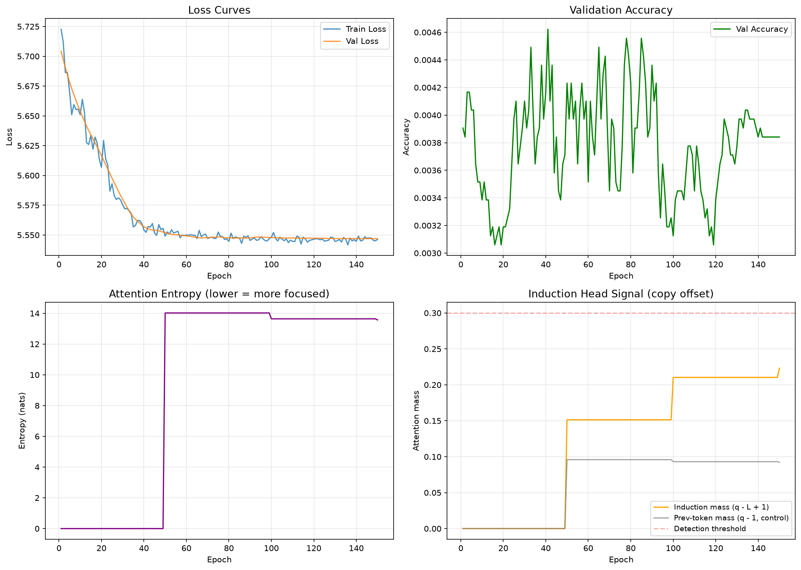

**Problem**: Detect and verify induction heads in a small 2-layer attention-only transformer trained on repeated random tokens. Induction heads implement the algorithm `[A][B]...[A] -> [B]` — they attend from the current token to its previous occurrence and copy the next token.

**Methodology**:
- Train 2-layer attention-only transformer on repeated random token sequences (Olsson et al. 2022)
- Identify induction heads via K-composition diagnostic (Nanda & Jacobsen 2023): L1 head composes with L0 duplicate-token head
- Verify causal role via head ablation and activation patching
- Track Step 1 (L0 duplicate mass) and Step 2 (K-composition) independently

**Key Result**:
<!-- manifest: results/exp1_induction_heads.json -->
Matched fixed-vs-fresh-batches comparison (800 epochs, identical config): fresh batches reach 53.5% val accuracy with no train/val gap, while the fixed reused dataset collapses to 0.46% val accuracy. The head counts this rung used to publish were **retracted** (2026-10-19): the detector measured the previous-token offset (`q-1`) instead of the copy offset (`q-(L-1)`), so "0/8 heads" was a statement about the detector. With the corrected detector the standard-scale run (GPU, 3 seeds, re-measured 2026-11-17 after a seeding fix) confirms **3 heads per seed**, all in the first layer, with a copy-offset mass of 0.81 and a K-composition of 0.08; the dissociation probe puts the copy on the fixed offset (period mass 0.81 vs content mass 0.03), so these are **prefix-copying heads**, not induction heads.

On the **content-based** task (the one that removes the positional shortcut; issue #200, GPU run 2026-11-09, repeated 2026-11-17 after the seeding fix) both verdicts are now **NEGATIVE on all three seeds**:

| | Pre-registered (training run alone) | Causal addendum (+ the path-patching cascade) |
|---|---|---|
| Seeds 0, 1, 2 | NEGATIVE, NEGATIVE, NEGATIVE | NEGATIVE, NEGATIVE, NEGATIVE |
| Run | **NEGATIVE** | **NEGATIVE** |

Before the fix the pre-registered run verdict was PARTIAL (seed 0 PARTIAL) and the addendum made seed 0 POSITIVE; the first run is kept as `results/induction_content_pre_seedfix.json`. The mechanism report (secondary by construction) says what is going on: the copy is **content-based on 3/3 seeds** (0.9968–0.9997, against a 0.155–0.165 fixed-offset baseline), but the circuit is **one head on one seed** (single-head ablation drop 0.9469) and **a distributed group on the other two** (group ablation 0.9938 and 0.9940, best single head 0.8903 and 0.0275). The per-head rule confirms no head on any seed. The corrected detector reports the induction mass with the previous-token mass as a control.
<!-- manifest: results/induction_content.json -->
<!-- manifest: results/exp4_content.json -->

**Figure**:
 <!-- manifest: results/exp1_induction_heads.json -->

**Reproduce**: `uv run python -m src.experiments.exp1_induction_heads --quick` (smoke test) or `--standard` for the emergence-boundary run.

**Limitations**:
- Standard scale (d_model=64) may not reflect larger model dynamics
- Fresh-batches training prevents memorization but may slow induction emergence
- The head counts are retracted (2026-10-19); a detected head is called a *prefix-copying head* until the dissociation probe says the copy is content-based
- On a periodic task, copying by content and copying by a fixed offset are the same function — the probe is the only measurement that separates them
- On the content-based task the per-head confirmation fires on 0/3 seeds (it fired on 1/3 before the seeding fix), so this rung does **not** claim a content-based induction head; it claims a content-based *copy* whose circuit is not stable across seeds

**Links**:
- [RESULTS](../../RESULTS.md) — my honesty ledger and per-rung numbers
- [research-plan](../../../07_capstone/research-plan.md) — where this rung sits in the experiment ladder
- [induction-heads](../../../04_nlp_and_transformers/notes/induction-heads.md) — my full fixed-vs-fresh writeup

**Next Steps**:
- Explain the carrier: test the two-stage hypothesis (layer 0 writes *where*, layer 1 reads *what*) against the measured K-composition score of 0.058 / 0.071
- Run the SAE on the content-task checkpoint (a circuit that copies by content is a real target for dictionary learning)
