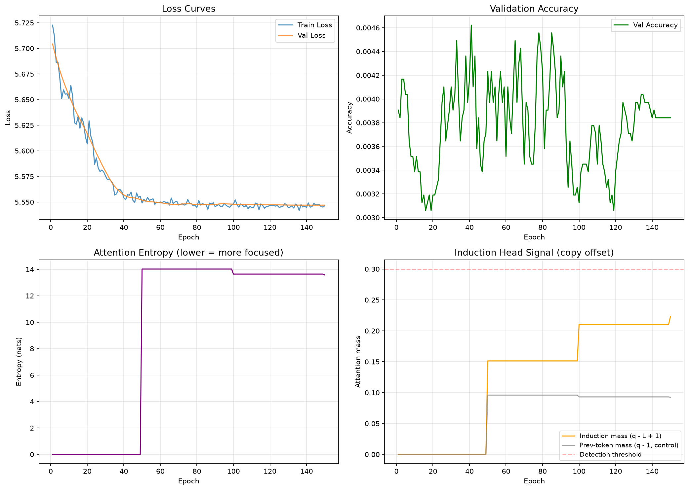

**Problem**: Detect and verify induction heads in a small 2-layer attention-only transformer trained on repeated random tokens. Induction heads implement the algorithm `[A][B]...[A] -> [B]` — they attend from the current token to its previous occurrence and copy the next token.

**Methodology**:
- Train 2-layer attention-only transformer on repeated random token sequences (Olsson et al. 2022)
- Identify induction heads via K-composition diagnostic (Nanda & Jacobsen 2023): L1 head composes with L0 duplicate-token head
- Verify causal role via head ablation and activation patching
- Track Step 1 (L0 duplicate mass) and Step 2 (K-composition) independently

**Key Result**:
<!-- manifest: results/exp1_induction_heads.json -->
Matched fixed-vs-fresh-batches comparison (800 epochs, identical config): fresh batches reach 53.5% val accuracy with no train/val gap, while the fixed reused dataset collapses to 0.45% val accuracy. The head counts this rung used to publish are **retracted** (2026-10-19): the detector measured the previous-token offset (`q-1`) instead of the copy offset (`q-(L-1)`), so "0/8 heads" was a statement about the detector. The corrected detector reports the induction mass with the previous-token mass as a control.

On the **content-based** task (the one that removes the positional shortcut; issue #200, GPU run 2026-11-09) the result is two verdicts, kept apart:

| | Pre-registered (training run alone) | Causal addendum (+ the path-patching cascade) |
|---|---|---|
| Seed 0 | PARTIAL | **POSITIVE** (7/7 criteria) |
| Seeds 1–2 | NEGATIVE | NEGATIVE |
| Run | **PARTIAL** | NEGATIVE (1/3 seeds positive — the frozen majority rule) |

and the mechanism report (secondary by construction) says why the two verdicts differ: the copy is **content-based on 3/3 seeds** (0.9976–1.0000, non-modal 0.9972–1.0000, against a 0.155–0.165 fixed-offset baseline) and it is carried by **one head** on 3/3 seeds (largest single-head ablation drop 0.9298 / 0.9402). What the per-head rule does not confirm on two seeds is the *form* of the circuit, not the copy: the carrier's attention mass on the content key (0.0886 / 0.1223) is below the 0.30 screen and its K-composition score (0.058 / 0.071) far below the 0.40 bar. The open question is now the mechanism — why the carrier does not attend to the content key.
<!-- manifest: results/induction_content.json -->
<!-- manifest: results/exp4_content.json -->

**Figure**:
 <!-- manifest: results/exp1_induction_heads.json -->

**Reproduce**: `uv run python -m src.experiments.exp1_induction_heads --quick` (smoke test) or `--standard` for the emergence-boundary run.

**Limitations**:
- Standard scale (d_model=64) may not reflect larger model dynamics
- Fresh-batches training prevents memorization but may slow induction emergence
- The head counts are retracted (2026-10-19); a detected head is called a *prefix-copying head* until the dissociation probe says the copy is content-based
- On a periodic task, copying by content and copying by a fixed offset are the same function — the probe is the only measurement that separates them
- On the content-based task the per-head confirmation fires on 1/3 seeds, so this rung does **not** claim a content-based induction head; it claims a content-based *copy* carried by one head

**Links**:
- [RESULTS](../../RESULTS.md) — my honesty ledger and per-rung numbers
- [research-plan](../../../07_capstone/research-plan.md) — where this rung sits in the experiment ladder
- [induction-heads](../../../04_nlp_and_transformers/notes/induction-heads.md) — my full fixed-vs-fresh writeup

**Next Steps**:
- Explain the carrier: test the two-stage hypothesis (layer 0 writes *where*, layer 1 reads *what*) against the measured K-composition score of 0.058 / 0.071
- Run the SAE on the content-task checkpoint (a circuit that copies by content is a real target for dictionary learning)
