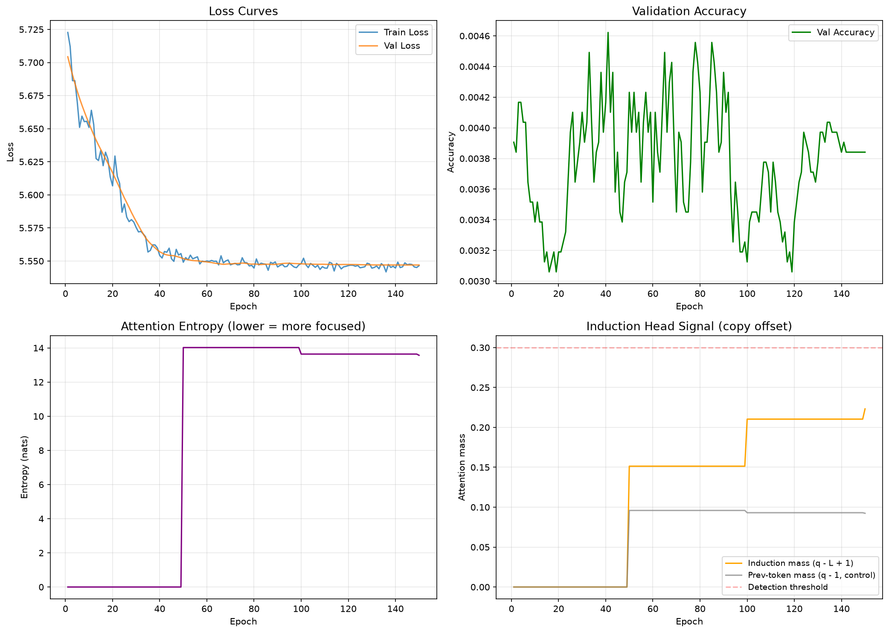

**Problem**: Detect and verify induction heads in a small 2-layer attention-only transformer trained on repeated random tokens. Induction heads implement the algorithm `[A][B]...[A] -> [B]` — they attend from the current token to its previous occurrence and copy the next token.

**Methodology**:
- Train 2-layer attention-only transformer on repeated random token sequences (Olsson et al. 2022)
- Identify induction heads via K-composition diagnostic (Nanda & Jacobsen 2023): L1 head composes with L0 duplicate-token head
- Verify causal role via head ablation and activation patching
- Track Step 1 (L0 duplicate mass) and Step 2 (K-composition) independently

**Key Result**:
<!-- manifest: results/exp1_induction_heads.json -->
Matched fixed-vs-fresh-batches comparison (800 epochs, identical config): fresh batches reach 53.5% val accuracy with no train/val gap, while the fixed reused dataset collapses to 0.45% val accuracy. The head counts this rung used to publish are **retracted** (2026-10-19): the detector measured the previous-token offset (`q-1`) instead of the copy offset (`q-(L-1)`), so "0/8 heads" was a statement about the detector. The corrected detector reports the induction mass with the previous-token mass as a control; the standard-scale run is issue #169.

**Figure**:
 <!-- manifest: results/exp1_induction_heads.json -->

**Reproduce**: `uv run python -m src.experiments.exp1_induction_heads --quick` (smoke test) or `--standard` for the emergence-boundary run.

**Limitations**:
- Standard scale (d_model=64) may not reflect larger model dynamics
- Fresh-batches training prevents memorization but may slow induction emergence
- The head counts are retracted (2026-10-19); the emergence boundary is an open measurement, and a detected head is called a *prefix-copying head* until the dissociation probe says the copy is content-based
- On a periodic task, copying by content and copying by a fixed offset are the same function — the probe is the only measurement that separates them

**Links**:
- [RESULTS](../../RESULTS.md) — my honesty ledger and per-rung numbers
- [research-plan](../../../07_capstone/research-plan.md) — where this rung sits in the experiment ladder
- [induction-heads](../../../04_nlp_and_transformers/notes/induction-heads.md) — my full fixed-vs-fresh writeup

**Next Steps**:
- Complete 10k epoch run and document emergence boundary
- Run SAE on first confirmed head checkpoint (Rung 5 dependency)
- Test at larger scales (d_model=128, 256)
