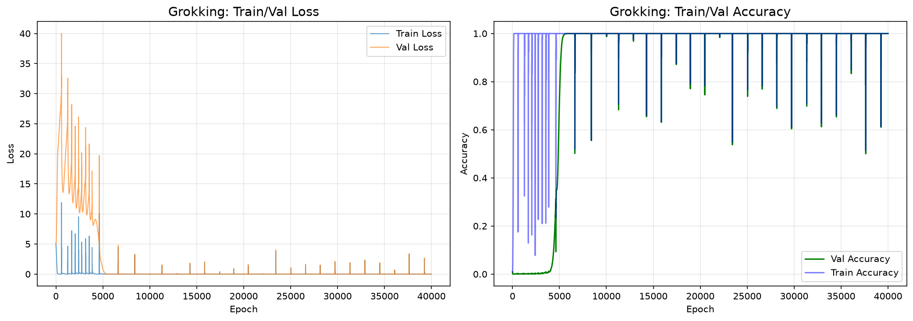
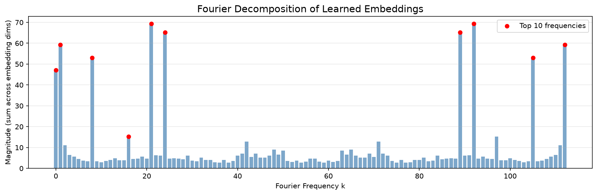
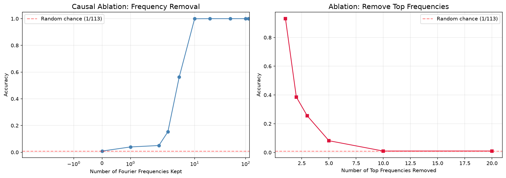
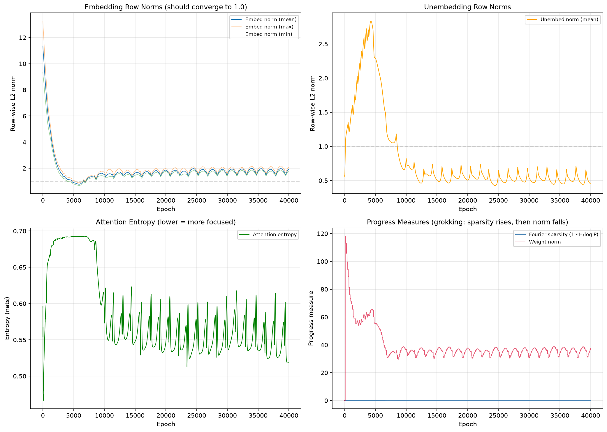

# Rung 2: Grokking Modular Addition

**Status: [x] REPRODUCED 2026-10-14.** The 2026-08-11 NO-GROK verdict was an artifact of the
L1-mass Fourier metric, falsified by the 2026-10-08 audit. Re-reading the same embeddings with
the post-audit energy metric shows the sparse Fourier circuit was present all along. See the
[Honesty Ledger](../../RESULTS.md#honesty-ledger) for the full audit trail.

## Problem

Train a 1-layer transformer on modular addition (a + b mod P) and observe delayed generalization
(grokking). Reverse-engineer the learned algorithm via Fourier decomposition of embeddings: the
canonical solution implements addition via discrete Fourier transforms and trigonometric
identities.

## Methodology

- Train 1-layer transformer on modular addition with P=113, 30% train fraction
- Observe grokking: validation loss drops sharply after extended training
- Fourier decomposition of token embeddings reveals sparse frequency structure
- Frequency ablation confirms mechanism: ablating key frequencies destroys generalization

## Key Result

<!-- manifest: results/grokking_nanda_p113.json -->
<!-- manifest: results/grokking_repo_p113_energy.json -->

P=113 GPU 3-seed run, decided 2026-10-14: **REPRODUCED** — the sparse Fourier circuit is real.

| Run | Protocol | val accuracy | k_energy_90 (of 56) | Sparse (energy criterion) |
|---|---|---|---|---|
| Job A | Nanda-faithful, 40k full-batch steps × 3 seeds | 0.9999 ± 0.0002 | 5.7 ± 1.2 | 3/3 seeds |
| Job B | historical repo protocol × 3 seeds | 1.0000 ± 0.0000 | 8.7 ± 1.2 | 3/3 seeds |

On the same embeddings the old L1-mass k₉₉ reads 109–110/113 (dense) — that classifier is the
2026-08-11 NO-GROK artifact, now retracted. See
[grokking-dense-attractor](../essay/grokking-dense-attractor.html) for the full reversal narrative.

## Figures

 <!-- manifest: results/grokking_nanda_p113.json -->
 <!-- manifest: results/grokking_nanda_p113.json -->
 <!-- manifest: results/grokking_nanda_p113.json -->
 <!-- manifest: results/grokking_nanda_p113.json -->

> Note: the four `exp2_*` figures above were generated from the historical CPU-era checkpoint
  (2026-08-13) and remain valid visualizations of the embeddings. Their dense captions predate
  the 2026-10-14 reversal and are scheduled for regeneration from a GPU re-run with figures
  enabled. The GPU checkpoints were remote scratch, so this needs a re-run, not a re-analysis.

## Reproduce

`uv run python -m src.experiments.exp2_grokking --quick` (smoke test); full P=113 via
`notebooks/kaggle_grokking_p113.ipynb` on GPU (issue #167).

## Limitations

- No sparse Fourier solution was ever produced under the L1-mass reading; the energy reading is
  the one that classifies the solution as sparse
- The P=59 positive control's NO-GROK label carries the same L1 metric defect (checkpoints gone;
  re-measure pending)
- Small model (1-layer, d_model=128) — larger models may behave differently
- The four tracked figures need regeneration from a GPU run (see Figures note above)

## Links

- [RESULTS](../../RESULTS.md) — my honesty ledger and per-rung numbers
- [research-plan](../../../07_capstone/research-plan.md) — where this flagship sits in the experiment ladder
- [grokking-verdict-p113](../../../07_capstone/notes/grokking-verdict-p113.md) — full verdict analysis
- [grokking essay](../essay/grokking-dense-attractor.html) — the reversal narrative

## Next Steps

- Regenerate the four `exp2_*` figures from a GPU re-run with figures enabled
- Re-measure the P=59 positive control with the energy metric (dedicated GPU job)
